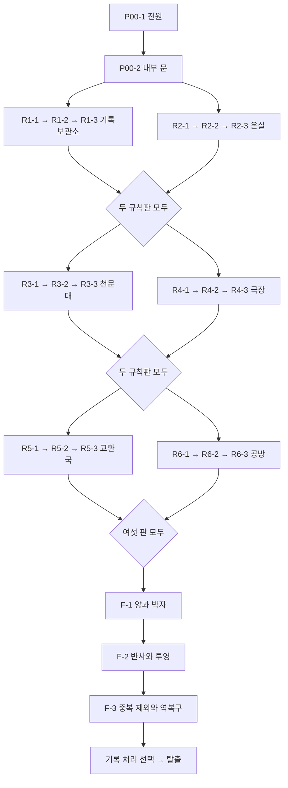

# 퍼즐 선행 관계와 교착 방지

아래는 기획상 관문이다. 모든 실제 입력 상태의 도달 가능성을 검증한 그래프가 아니다. [자동 검사](../validation/verify_puzzles.py)는 이 선행 관계에 순환이 없는지와 선택 문제가 필수 관문이 아닌지만 확인한다.

## 정확한 단위 의존

| 노드 | 필요한 해결 사실 |
|---|---|
| P00-1 | 없음 |
| P00-2 | P00-1 |
| R1-1, R2-1 | P00-2 |
| 각 방 Rn-2 | 같은 방 Rn-1 |
| 각 방 Rn-3 | 같은 방 Rn-2 |
| R3-1, R4-1 | R1-3과 R2-3 모두 |
| R5-1, R6-1 | R3-3과 R4-3 모두 |
| F-1 | R5-3과 R6-3 모두. 앞 단계 관문 때문에 다른 네 판도 이미 보유 |
| F-2 | F-1 |
| F-3 | F-2 |
| O-n | 해당 방 Rn-2. 다른 노드의 선행 조건으로 사용하지 않음 |

Rn은 n=1~6의 각 방을 뜻한다. 기획 명세에는 AND 관문이므로 위쪽 경로 하나만 해결해 다음 두 방을 열면 안 된다.

## 필수 증거의 출처

| 나중에 쓰는 관계 | 처음 배우는 필수 장치 | 재확인 위치 |
|---|---|---|
| 실제 사건을 정렬하고 역순 복구 | R1-1·3 | 기록 연표, 순서 규칙판 |
| 모든 물의 총량과 경로 제약 | R2-2 | 계량통 안내, 양과 때 규칙판 |
| 열린 박자와 복수 조건 | R2-3·R6-2 | 주기표·고리, 공방 규칙판 |
| 좌표와 거울 반사 | R3-1·2 | 북쪽 홈, 반사 도해, 관측 규칙판 |
| 고정된 앞 조각과 깊이별 투영 | R4-2 | 정비도, 투영 규칙판 |
| 같은 번호와 실제 인도 구분 | R5-2 | 수신/처리 도장, 번호 규칙판 |

선택 원본은 작성자를 확인할 뿐 위 표의 규칙을 독점하지 않는다. 규칙판을 얻으면 핵심 도해를 수첩에 자동 등록해, 확대면을 닫은 뒤 원문을 다시 얻을 수 없게 되는 상황을 막는다.

## 의도한 교착 방지와 실제 확인 항목

| 위험 상황 | 기획상 방지 | 구현 뒤 확인해야 할 것 |
|---|---|---|
| 틀린 물품 사용·물 분배 | 회수·순환, 필수 소모품 없음 | 취소·중단 중 물품 중복/소실 없음 |
| 한 방에서 막힘 | 같은 단의 다른 방으로 언제든 이동 | 확대·실험 도중에도 안전하게 나갈 수 있음 |
| 해결 직후 초기화 | 현재 장치의 연습 상태만 리셋 | 전역 해결 사실·다음 방문 유지 |
| 선택 원본을 놓침 | 모든 이전 방 재방문, 필수 관문과 독립 | 엔딩 선택 전에도 원본 회수 가능 |
| 우편 인도 중 저장 | 41·42의 실제 처리와 확인을 분리 | 불러온 뒤 같은 번호를 두 번 인도하지 않음 |
| 마지막 선택 뒤 다른 엔딩 확인 | 선택 직전 저장 지점 유지 | 선택하지 않은 결말·이름이 섞이지 않음 |
| 공방 기어 중간 순서 변경 | 두 동치 배치 모두 허용 | 그림과 수치 계산의 방향·비율 일치 |
| 빠르게 여러 번 제출 | 해결 상태는 한 번만 확정 | 규칙판·물품·문 열기가 중복 처리되지 않음 |

이 방지책은 설계 계약이며 현재 게임의 무교착 증거가 아니다. 실제 상태 전환, 저장, 애니메이션 취소가 추가되면 별도의 교착·복원 검증이 필요하다.
